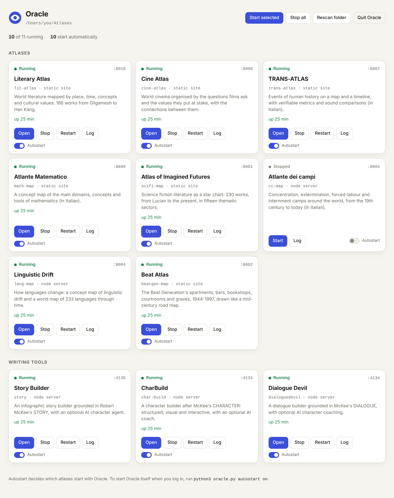

# Oracle

Oracle starts all your web atlases with one command. Put the atlases in one folder (the *atlas folder*). Oracle starts the ones you've selected, each on its own port, and gives you a dashboard at **http://localhost:8800** where you can open, stop and restart them. It can also start itself when you log in.



It is a single Python file (`oracle.py`) that uses only the standard library. You need:

- **Python 3.8+** for Oracle itself and for the static atlases;
- **Node.js 20+** for the atlases that run their own server (cc-map, lang-map, story, char-build, dialoguedevil);
- **git** only if Oracle should download the atlases for you.

## Quick start

```bash
git clone https://github.com/fopearcano/oracle.git
```

```bash
cd oracle
```

1. **Tell Oracle where the atlas folder is.** This is the folder that holds the clones (`~/Atlases/lit-atlas`, `~/Atlases/story`, …):

   ```bash
   python3 oracle.py config --db ~/Atlases
   ```

   If you skip this, Oracle uses the `db/` folder next to `oracle.py`.

2. **Fill the folder.** Copy or clone the atlases into it yourself, or let Oracle clone every atlas that is missing and update the ones already there:

   ```bash
   python3 oracle.py sync
   ```

3. **Start them:**

   ```bash
   python3 oracle.py
   ```

   The dashboard opens in your browser. Ctrl+C stops Oracle and every atlas it started.

On macOS you can double-click `start-oracle.command`. On Windows, double-click `start-oracle.bat`.

## The atlases

Oracle knows these from [`atlases.json`](atlases.json). Each one keeps the port given in its own README, so your bookmarks keep working.

| Atlas | Port | How it runs |
|---|---|---|
| lit-atlas: Literary Atlas | 8010 | static site |
| cine-atlas: Cine Atlas | 8008 | static site |
| trans-atlas: TRANS-ATLAS | 8007 | static site |
| math-map: Atlante Matematico | 8099 | static site |
| scifi-map: Atlas of Imagined Futures | 8001 | static site |
| cc-map: Atlante dei campi | 8005 | `node server.js` |
| lang-map: Linguistic Drift | 8004 | `node server.js` |
| beatgen-map: Beat Atlas | 8002 | static site |
| story: Story Builder | 4135 | `node server.js`, runs `npm install` the first time |
| char-build: CharBuild | 4133 | `node server/index.js`, runs `npm install` the first time |
| dialoguedevil: Dialogue Devil | 4134 | `node server.js`, runs `npm install` the first time |

Oracle serves the static sites itself and tells the browser to re-check every file, so after a `git pull` you never get stale scripts.

**story, char-build and dialoguedevil** keep their app on a side branch; their `main` branch holds only the book. `oracle.py sync` clones them on the right branch. If a clone is already sitting on `main`, `sync` switches it, provided nothing in the clone would be lost. The dashboard tells you when this is needed.

### Adding another atlas

Put its folder in the atlas folder and press **Rescan folder** on the dashboard (or restart Oracle). Oracle works out how to start it:

- a `package.json` start script like `python3 -m http.server 8010` or `python3 scripts/serve.py 8007` → static site on that port;
- a start script like `node server.js` → Node server, with the port taken from `process.env.PORT || 1234` in that file;
- any other start script → `npm start`;
- just an `index.html` (or `public/index.html`) → static site, with the port taken from `localhost:NNNN` in the README.

If the port is unknown or already taken, Oracle picks a free one from 8100 upward. To pin a title, port or start command, add an entry to `atlases.json`:

```json
{ "name": "my-map", "title": "My Map", "kind": "static", "port": 8020 }
{ "name": "api",    "kind": "node", "entry": "src/server.js", "port": 3000 }
{ "name": "odd",    "kind": "cmd",  "cmd": ["{python}", "serve.py", "--port", "{port}"], "port": 8030 }
```

Node servers get `PORT` and `HOST` in their environment. `cmd` can use `{port}`, `{host}`, `{python}` and `{dir}`.

## Choosing which atlases start

Every atlas in the folder starts automatically unless you turn it off. Use the **Autostart** switch on its dashboard card, or:

```bash
python3 oracle.py deselect cc-map lang-map
```

```bash
python3 oracle.py select cc-map
```

```bash
python3 oracle.py list
```

Atlases you add to the folder later start automatically too. For a single run you can override the selection: `python3 oracle.py --only lit-atlas story` starts just those two, and `python3 oracle.py --all` starts everything.

## Starting Oracle when you log in

```bash
python3 oracle.py autostart on
```

This registers Oracle to run in the background at login, without opening a browser. Bookmark http://localhost:8800. `autostart off` removes it, and `autostart status` tells you whether it is on.

| System | What gets installed |
|---|---|
| macOS | `~/Library/LaunchAgents/local.oracle.atlases.plist` (a LaunchAgent) |
| Windows | `Oracle atlases.vbs` in your Startup folder (runs with no console window) |
| Linux | `~/.config/autostart/oracle-atlases.desktop` |

The autostarted Oracle uses the folder set with `config --db`, so set that first. On macOS, keep `oracle.py` and the atlas folder outside Desktop, Documents and Downloads: macOS can block programs started at login from reading those folders.

To stop the background Oracle and all its atlases, use **Quit Oracle** on the dashboard, or run:

```bash
python3 oracle.py stop
```

## Using it from a phone or another computer

By default, the atlases and the dashboard listen on this computer only. To open them to your home network:

```bash
python3 oracle.py config --lan on
```

Then restart Oracle. To try it for one run without saving the setting, use `python3 oracle.py --lan`.

- **Access code.** Oracle makes one up, such as `k7mp-q2xa`. The dashboard on this computer shows it at the top, together with the address other devices should open, and `python3 oracle.py config` prints it too.
- **On the phone**, open that address (for example `http://192.168.1.20:8800`) and enter the code once. The phone then stays signed in for 30 days. Capital letters, spaces and dashes in the code don't matter.
- **What other devices can do:** open, start, stop and restart atlases, download missing ones, and switch Autostart. Only this computer can quit Oracle, so nobody locks you out from the sofa.
- **Changing the code:** `python3 oracle.py config --new-code` makes a new random one, and `python3 oracle.py config --code "your own code"` sets one you choose. Every device that used the old code is asked for the new one.
- **Wrong codes:** after five wrong codes, a device has to wait ten minutes before it can try again.
- **Who can connect:** only devices on a private network, such as home Wi-Fi or a VPN like Tailscale. Public internet addresses are refused, even if you forward the port. The connection is plain HTTP, so use LAN mode on networks you trust: at home, not on café Wi-Fi.
- **The atlases themselves have no code.** With LAN mode on, anyone on the network can open them. The writing tools keep their own protections. Dialogue Devil can ask for its own code if you set `DD_ACCESS_CODE`, and CharBuild lets only this computer change its AI settings. Story Builder lets anyone who reaches it use an API key set on the server, such as `ANTHROPIC_API_KEY`.
- **Firewall:** the first time, macOS or Windows may ask whether Python or Node may accept incoming connections. Allow it, or other devices won't get through.

## Commands

| Command | What it does |
|---|---|
| `oracle.py` or `oracle.py start` | Start the selected atlases and the dashboard. Options: `--db DIR`, `--port N`, `--no-browser`, `--lan`, `--all`, `--only NAME…` |
| `oracle.py list` | Show each atlas, its port, whether it starts automatically, and its state |
| `oracle.py select NAME…` / `deselect NAME…` | Turn autostart on or off for these atlases (`--all` for every one) |
| `oracle.py sync [NAME…]` | Clone missing atlases from GitHub and fast-forward the others (`--selected` for only the selected ones) |
| `oracle.py stop` | Stop a running Oracle and every atlas it started |
| `oracle.py config` | Show the settings, or change them with `--db DIR`, `--port N`, `--lan on/off`, `--code CODE`, `--new-code` |
| `oracle.py autostart on/off/status` | Start Oracle at login |

Settings are saved in `oracle.config.json` next to `oracle.py`. `--db` on a single command, or the `ORACLE_DB` environment variable, overrides the saved folder for that run only.

## Good to know

- **Network access.** Everything listens on this computer only until you turn LAN mode on (see [Using it from a phone or another computer](#using-it-from-a-phone-or-another-computer)).
- **"Already running".** If something already answers on an atlas's port (for example, you started it by hand), Oracle leaves it alone and shows it as *Already running*.
- **Logs.** Each atlas writes its output to `logs/<name>.log`. The dashboard's **Log** button shows the latest part. When an atlas crashes or can't start, the card tells you why.
- **AI features.** story, char-build and dialoguedevil still take their API key the usual way: in their own Settings, from char-build's `.env`, or from variables such as `ANTHROPIC_API_KEY`. Oracle passes its environment through, so a key that is set when Oracle starts reaches them.

## Tests

```bash
python3 -m unittest discover tests
```
